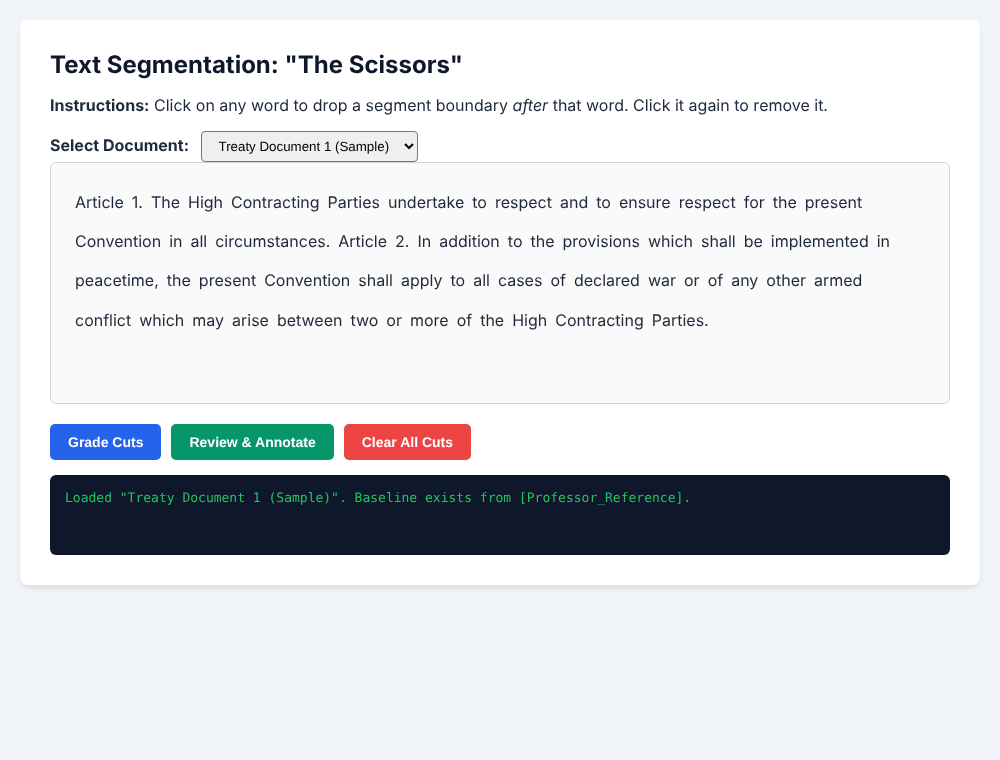
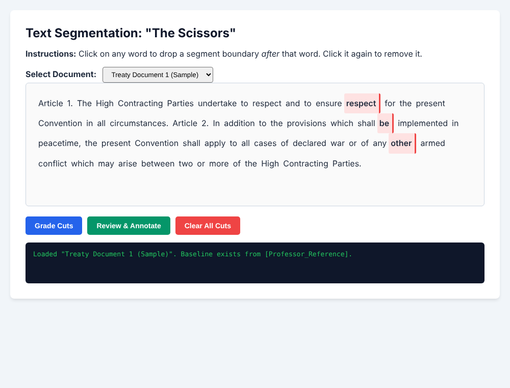
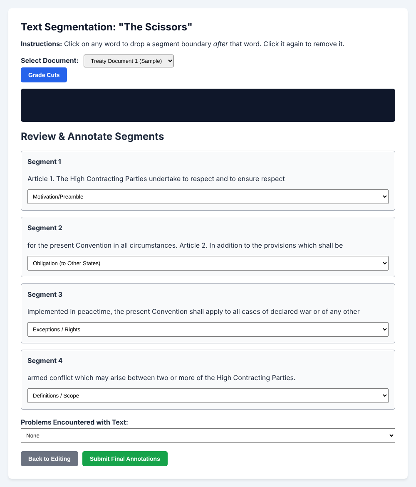
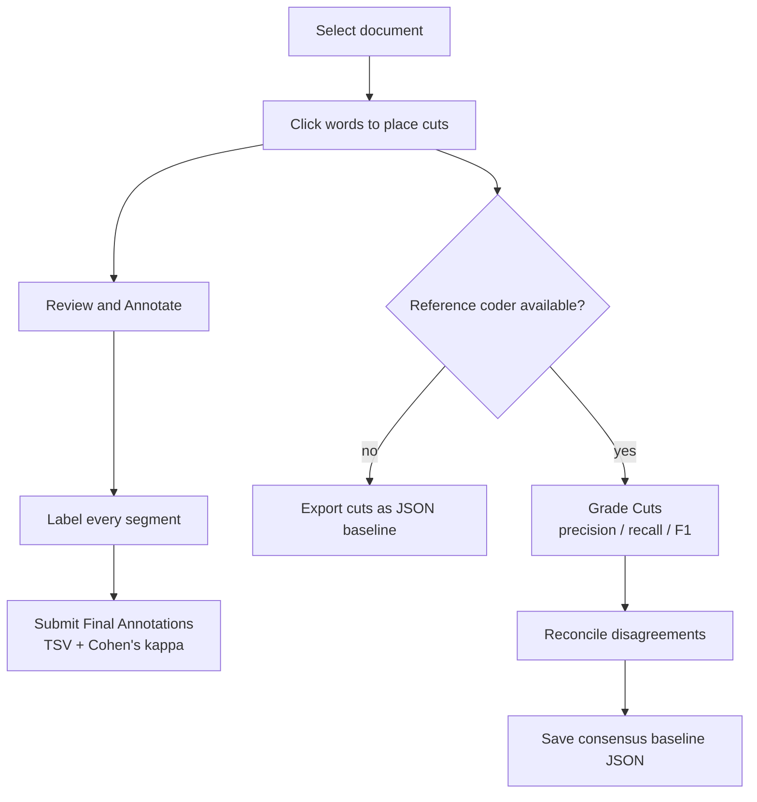

# Treaty Segmentation & Annotation Tool ("The Scissors")

A browser-based tool for **segmenting and annotating legal text** for qualitative research. Coders click between words to cut a treaty into segments, label each segment with a category, and the tool measures how closely two coders agree, both on *where* the boundaries are and on *how* the segments are categorized.

It runs entirely in the browser. There is no server, no build step, and no dependencies.

> Developed during the CMU Summer Undergraduate Research Apprenticeship (SURA), 2026.



---

## Summary

Qualitative coding projects need more than one person to code the same text, and then a way to show that the coders agree. This tool covers that whole loop in one page:

1. **Segment**: click a word to drop a boundary after it.
2. **Annotate**: assign each resulting segment a category.
3. **Grade**: compare your boundaries with a reference coder's (precision, recall, F1).
4. **Check category agreement**: compute Cohen's kappa against the reference annotations.
5. **Reconcile**: resolve disagreements and save a consensus baseline.
6. **Export**: download clean TSV files ready for R, Python, or Excel.

## Walkthrough

**1. Place boundaries.** Click any word to cut after it; click again to remove the cut. Cuts are saved in the browser per document, so a refresh does not lose work.



**2. Review and annotate.** Each segment gets its own box and category dropdown. Submission is blocked until every segment is labeled.



## Requirements

- A modern browser (Chrome, Edge, Firefox, Safari).
- Nothing else. No libraries or CDN imports are loaded.

## Installation

```bash
git clone https://github.com/woojook/SURA-segmengationApp-jcanfil.git
cd SURA-segmengationApp-jcanfil/segmentation
```

## Examples

Open `index.html` in a browser, or serve the folder locally:

```bash
python -m http.server 8000
# then visit http://localhost:8000
```

On first use the tool asks for a **coder ID** and remembers it for the browser session.

## Parameters

Configuration lives at the top of `segmentation/app.js`.

**`DOCUMENTS_MANIFEST`**: the list of texts to code.

```js
const DOCUMENTS_MANIFEST = [
  { title: "Treaty Document 1 (Sample)", url: "data:text/csv;..." }   // sample is embedded
  // { title: "Treaty 2", url: "https://example.com/treaty2.csv" }    // or point to a hosted CSV
];
```

**Document CSV**: the tool reads the text from column 1 of the first data row and splits it on whitespace into words. A custom parser handles quoted fields, doubled quotes (`""`), and both CRLF and LF line endings.

```csv
id,text
1,"Article 1. The High Contracting Parties undertake to respect ..."
```

**Reference cuts** (optional): a JSON object keyed by document title, giving a reference coder's boundaries and, optionally, their annotations.

```json
{
  "Treaty Document 1 (Sample)": {
    "coder": "Professor_Reference",
    "cuts": [13, 30]
  }
}
```

Each number is the index of the word *after which* a cut falls. Add an `annotations` array (one category per segment) to enable the kappa check.

## Returns

| Output | Format | When |
|---|---|---|
| Annotation file | `.tsv` | **Submit Final Annotations** |
| Boundary comparison | shown in the on-page console | **Grade Cuts**, when a reference exists |
| Consensus baseline | `.json` | **Save Consensus Baseline** |
| Coder's cuts | `.json` | **Grade Cuts**, when no reference exists (labelled "Coder 1") |

**TSV columns:** `timestamp`, `segid`, `user`, `coding`, `segment_id`, `segment`, `annotation_type`, `annotation_other`, `title`, `date`.

`coding` encodes the boundaries as `cut_` followed by the sorted word indices, for example `cut_13_30`.

## How It Works

### Workflow



### Agreement metrics

**Boundary agreement.** A boundary counts as matched only when both coders cut after the *same* word (an exact match, with no positional tolerance).

$$
P = \frac{|C \cap R|}{|C|}, \qquad
R = \frac{|C \cap R|}{|R|}, \qquad
F_1 = \frac{2PR}{P + R}
$$

where $C$ is the coder's set of cuts and $R$ is the reference set.

**Category agreement.** Cohen's kappa compares the coder's labels with the reference labels, segment by segment:

$$
\kappa = \frac{p_o - p_e}{1 - p_e}
$$

where $p_o$ is the observed proportion of matching labels and $p_e$ is the agreement expected by chance, computed from each coder's label frequencies. If chance agreement is already perfect, $\kappa$ is set to 1.

### Reconciliation

The reconciliation panel shows the union of both coders' cuts. Cuts both coders made are marked **Agreed Boundary** (green); disagreements are marked red with a checkbox, so the coder can adjudicate each one before saving the consensus.

### Data hygiene for downstream tools

Free text inside a TSV can silently break R, Python, and Excel imports. Every cell goes through a sanitizer first:

| Problem in the text | What the sanitizer does |
|---|---|
| Line breaks (`\r`, `\n`) | Replaced with a space |
| Tabs | Replaced with a space |
| Quote characters | Doubled, so they stay valid inside a quoted cell |
| `null` / `undefined` | Written as an empty string |
| The whole value | Wrapped in quotes |

The file is generated in the browser as a Blob and downloaded locally. No data leaves the machine.

## Notes

- **State is local.** Cuts are stored in `localStorage` per document, and the coder ID in `sessionStorage`.
- **No server, no accounts.** This makes the tool easy to host as a static page and keeps coder data on the coder's own computer.
- **Exact matching is deliberate and strict.** It keeps the metric simple and unambiguous, but see Limitations.

## Limitations

- Boundary matching has no tolerance, so a cut one word away from the reference counts as a miss.
- Category agreement is computed by *position*, on the first N segments where both coders have labels. It assumes both coders produced the same number of segments in the same order.
- The sample reference file has no `annotations`, so kappa is not shown for the sample document.
- The "Problems Encountered" dropdown is written to the `annotation_other` column of the TSV.

## Project Layout

```
.
├── documents/
│   └── example.csv        # sample text
└── segmentation/
    ├── index.html         # page structure and controls
    ├── app.js             # segmentation, annotation, metrics, export
    ├── style.css          # styling
    └── documents/
        └── example.csv
```

## References

1. Cohen, J. (1960). A coefficient of agreement for nominal scales. *Educational and Psychological Measurement*, 20(1), 37-46.
2. Manning, C. D., Raghavan, P., & Schütze, H. (2008). *Introduction to Information Retrieval*, ch. 8: precision, recall, and F-measure. Cambridge University Press.

## Author

Woojoo Kim, Carnegie Mellon University.
